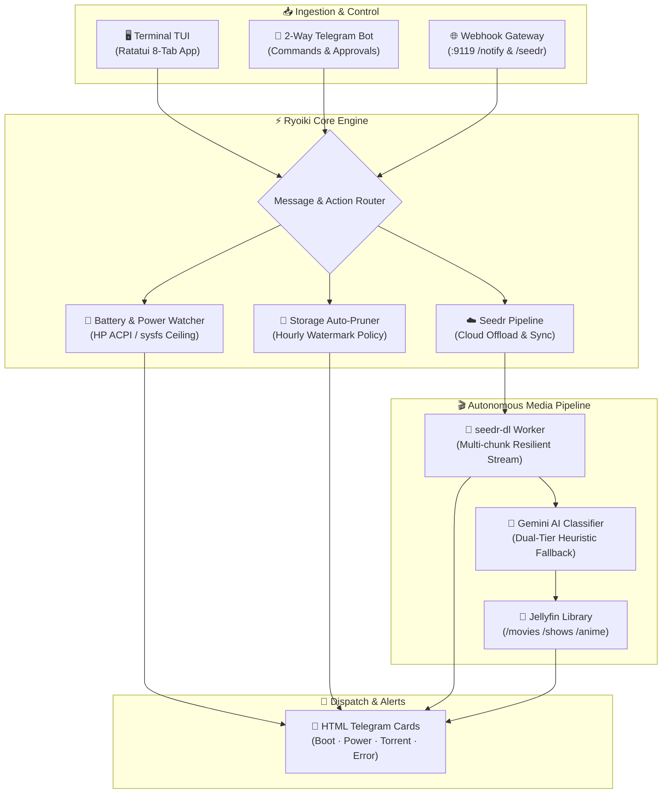

<div align="center">

# 🌸 領域 (Ryoiki)

> **Aesthetic Ubuntu server control center: provision, tune battery health, inspect services, and orchestrate torrents & media from one terminal.**

[](https://github.com/Praveensenpai/ryoiki/releases/latest)
[](https://github.com/Praveensenpai/ryoiki/actions)
[](Cargo.toml)
[](https://ubuntu.com/)
[](https://github.com/Praveensenpai/ryoiki/releases)
[](LICENSE)

<br>

[⚡ Quickstart](#-quickstart) • [✨ Features](#-features) • [🔄 Architecture](#-architecture--workflow) • [🧩 Modules](#-provisioning-modules) • [⌨️ Keybindings](#%EF%B8%8F-control-center-keybindings) • [💻 CLI Usage](#%EF%B8%8F-cli-usage--commands) • [⚙️ Configuration](#%EF%B8%8F-configuration)

<br>

</div>

```text
┌──────────────────────────────────────────────────────────────────────────┐
│  領域 Ryoiki · Control Center                              v0.2.12       │
│  ● mochi   │  AC connected  │  62%  │  up 1h  │  Battery                 │
├──────────────────┬───────────────────────────────────────────────────────┤
│ Menu             │ Battery  Charge ceiling and low-battery policy        │
│  1 Dashboard     │  Max charge ceiling            ● on                   │
│  2 Provision     │  Ceiling percent               ◀ 60% ▶                │
│  3 Battery       │  ─────────────────────────────────────────────────    │
│  4 Notifications │  Auto poweroff                 ● on                   │
│  5 Services      │  Shutdown at                   ◀ 5% ▶                 │
│  6 Media         │  ─────────────────────────────────────────────────    │
│  7 Updates       │  Apply ceiling to hardware     enter ↵                │
│  8 Settings      │  Restart battery watcher       enter ↵                │
│                  │  Edit alert thresholds         enter ↵                │
│  5s auto-refresh │  Alert thresholds  50% · 40% · 30% · 25% · 15% · 5%   │
├──────────────────┴───────────────────────────────────────────────────────┤
│ j/k move · h/l tabs · ←/→ adjust · Enter · Tab pane · ? help · q quit    │
└──────────────────────────────────────────────────────────────────────────┘
```

---

## ⚡ Quickstart

> [!IMPORTANT]
> **One command. Zero git clone. Zero build toolchains. Zero compile overhead.**

### 🪄 One-Liner Magic (Recommended)

Paste and run on any fresh Ubuntu or Debian server:

```bash
curl -fsSL https://raw.githubusercontent.com/Praveensenpai/ryoiki/main/remote-install.sh | bash
```

The installer autonomously handles setup in seconds:
1. **Detects CPU Architecture** — Fetches the pre-compiled `x86_64` binary straight from GitHub Releases.
2. **Rootless Binary Placement** — Installs cleanly to `~/.local/bin/ryoiki` without requiring root permissions.
3. **Deploys System Hooks** — Configures udev power rules, battery-watch systemd unit, and boot/login alert hooks.
4. **Launches Control Center** — Instantly boots the interactive terminal dashboard.

<br>

### 🛠️ Building From Source

```bash
git clone https://github.com/Praveensenpai/ryoiki.git
cd ryoiki
cargo build --release
install -Dm 755 target/release/ryoiki ~/.local/bin/ryoiki
```

---

## 🔄 Architecture & Workflow

Ryoiki acts as an autonomous nervous system for your server, coupling terminal TUI control, remote 2-way Telegram management, power safeguards, and an automated media ingestion pipeline.



---

## ✨ Features

- 🎛️ **Persistent Control Center** — An eight-tab Ratatui interface for live metrics, provisioning, battery policy, Telegram notifications, systemd services, media, updates, and local settings.
- 🔋 **Battery Health Guardrails** — Hardware-enforced charge ceiling (via HP ACPI and sysfs) with auto-poweroff protection at custom low-battery thresholds.
- 🖥️ **Live System Dashboard** — Real-time CPU, RAM, disk, battery gauge, AC status, charge backend, and watcher health. Probes run on background workers so navigation stays instant.
- ☁️ **Seedr Cloud Offloader** — Instantly offloads torrents and magnets to Seedr cloud, freeing host bandwidth and avoiding duplicate downloads.
- 🔄 **Resilient Media Streamer** — Multi-threaded chunked downloads via `seedr-dl` with exponential retry backoff, DNS fallback, and automatic connection recovery.
- 🤖 **Autonomous AI Media Classifier** — Classifies incoming torrents via Google Gemini (`gemini-3.1-flash-lite`) with offline deterministic regex heuristics fallback, moving files straight into Jellyfin hierarchies.
- 🧹 **Storage Auto-Pruner** — Automatically monitors storage watermark (e.g. 90% trigger down to 75% target) and purges watched media gracefully.
- 📱 **2-Way Telegram Command Center** — Control your server from anywhere: inspect torrents, query server status, restart services, approve actions, and receive rich HTML status cards.
- 🛡️ **Hardened Server Security** — Automated UFW firewall configuration (ports 22, 80, 443), unneeded daemon cleanup, and SSH login alerts via PAM.
- 🌐 **Tailscale & MagicDNS** — Embedded WireGuard mesh support. Connect via `ssh user@hostname` from anywhere without static IPs, port forwarding, or NAT traversal issues.
- 📦 **Zero-Clone Embedded Dotfiles** — Pre-configured modern templates (`.tmux.conf`, `.bash_aliases`, `starship.toml`) embedded directly into the binary with `include_str!`.
- 🦀 **Strict Rust Standards** — Built under strict quality limits: `<400` LOC per file, `<60` LOC per function, zero production `unwrap()`/`expect()`, and zero Clippy warnings.

---

## 🧩 Provisioning Modules

| # | Module | Identifier | Included Components & Configuration |
|:---:|:---|:---|:---|
| `01` | **Git & SSH Key** | `git_ssh` | Ed25519 SSH keypair generation, GitHub CLI association & connection test |
| `02` | **System Essentials** | `essentials` | `git`, `tmux`, `neovim`, `adb`, `curl`, `build-essential`, official GitHub CLI (`gh`), OpenCode AI agent |
| `03` | **Modern CLI Suite** | `cli_tools` | `eza` (modern ls), `bat` (cat with wings), `zoxide` (smart cd), `fzf`, `ble.sh` |
| `04` | **Dev Runtimes** | `dev_runtimes` | Latest stable Go, Rust toolchain (`rustup`), Python (`uv`), JavaScript (`bun`) |
| `05` | **Server Security** | `security` | UFW Firewall (ports 22, 80, 443) & unneeded daemon cleanup |
| `06` | **Docker Platform** | `docker` | Official Docker CE Engine, `containerd`, and Docker Compose v2 plugin |
| `07` | **Jellyfin Media Server** | `jellyfin` | Dockerized media streaming with Intel QuickSync / VAAPI GPU hardware acceleration |
| `08` | **qBittorrent Server** | `torrent` | Dockerized BitTorrent client with Web UI (port 6881) & peer ports |
| `09` | **Shell Prompt** | `prompt` | Cross-shell Starship prompt with Nerd Font glyphs & Fastfetch CLI |
| `10` | **Trash Manager** | `trash` | `toss-rs` safe terminal trash TUI with FreeDesktop spec & safe `rm` alias |
| `11` | **Tailscale Mesh VPN** | `tailscale` | WireGuard mesh, MagicDNS (hostname SSH) & Tailscale SSH without static IP |
| `12` | **Aesthetic Dotfiles** | `dotfiles` | Zero-clone deployment of embedded `~/.tmux.conf`, `~/.bash_aliases`, and `starship.toml` |
| `13` | **AI Media Organizer** | `media` | Automated Jellyfin library classifier & mover (Gemini Flash-Lite Primary + Regex fallback) |
| `14` | **Headless Audio Null Sink** | `headless_audio` | Routes default ALSA PCM/CTL to a null device via `~/.asoundrc` |

---

## ⌨️ Control Center Keybindings

| Key | Action |
|:---:|:---|
| <kbd>q</kbd> / <kbd>Ctrl-C</kbd> | Quit and restore the terminal |
| <kbd>?</kbd> | Toggle the help overlay |
| <kbd>Tab</kbd> | Switch focus between the menu and content panes |
| <kbd>1</kbd>–<kbd>8</kbd> | Jump to Dashboard, Provision, Battery, Notifications, Services, Media, Updates, or Settings |
| <kbd>j</kbd> / <kbd>k</kbd> / <kbd>↑</kbd> / <kbd>↓</kbd> | Move the cursor |
| <kbd>h</kbd> / <kbd>l</kbd> / <kbd>←</kbd> / <kbd>→</kbd> | Previous/next tab in the menu, or adjust a stepper in content |
| <kbd>Enter</kbd> / <kbd>Space</kbd> | Activate the focused row or toggle a module/toggle |
| <kbd>g</kbd> / <kbd>G</kbd> | Jump to the first/last selectable row |
| <kbd>r</kbd> / <kbd>s</kbd> | Refresh the snapshot / save settings |
| <kbd>Ctrl-U</kbd> | Clear the active text input |
| <kbd>y</kbd> / <kbd>n</kbd> | Confirm or cancel a privileged action |

> Modals take over keyboard inputs: <kbd>Esc</kbd> cancels an input or confirmation, <kbd>Enter</kbd> saves an input, and any key closes the help overlay.

---

## 🛠️ CLI Usage & Commands

### 🎛️ Control Center & Provisioning
```bash
# Open the interactive 8-tab control center
ryoiki

# Open directly to the provisioning checklist
ryoiki install

# Preview provisioning changes without modifying system
ryoiki --dry-run

# Headless provisioning: run all modules non-interactively
ryoiki --all --yes

# Run specific modules by identifier
ryoiki run dev_runtimes docker security

# Audit installed system packages and CLI tools
ryoiki check

# Deploy embedded dotfiles only (~/.tmux.conf, ~/.bash_aliases, starship.toml)
ryoiki dotfiles

# In-place self-update to latest release from GitHub
ryoiki update
```

### 📱 Telegram Bot & Notifications
```bash
# Start 2-way Telegram bot & embedded webhook gateway (:9119)
ryoiki bot

# Dispatch custom Telegram alert card
ryoiki notify send "Database backup completed successfully" --title "Backup" --level success

# Dispatch system boot metrics notification
ryoiki notify boot

# Dispatch SSH login security alert (called via PAM or shell profile)
ryoiki notify login --user neko --ip 198.51.100.42

# Fire alert via local HTTP webhook (works from Docker, Python, curl)
curl -d "text=Service restart completed" http://127.0.0.1:9119/notify

# Install systemd boot service & PAM login notification hooks
ryoiki notify install-hooks

# Start battery watch daemon (alerts at 50%, 40%, 30%, 25%, 15%, 5%, 1%)
ryoiki notify battery-watch
```

### ☁️ Seedr Cloud & Media Pipeline
```bash
# Inspect active Seedr cloud caching & disk download progress
ryoiki seedr status

# Offload torrent/magnet to Seedr cloud (cleans up qBittorrent duplicates)
ryoiki seedr "magnet:?xt=urn:btih:..."

# Preview AI media classification without moving files
ryoiki media /path/to/downloads --dry-run

# Classify and organize media files into Jellyfin Movies/Shows/Anime
ryoiki media /path/to/downloads

# Media auto-prune: preview policy (triggers at 90%, recovers to 75%)
ryoiki prune --threshold 90 --target 75 --dry-run

# Deploy hourly media auto-prune systemd user timer
ryoiki prune --schedule
```

---

## ⚙️ Configuration

### 1. Unified Settings (`~/.config/ryoiki/settings.json`)

Written atomically and validated on every update:

```json
{
  "battery": {
    "max_charge_enabled": true,
    "max_charge_percent": 60,
    "alert_thresholds": [50, 40, 30, 25, 15, 5, 1]
  },
  "power": {
    "poweroff_on_low": false,
    "poweroff_percent": 5
  },
  "storage": {
    "prune_threshold": 90,
    "prune_target": 75
  },
  "ui": {
    "refresh_secs": 5
  }
}
```

### 2. Telegram & AI Config (`~/.config/ryoiki/telegram.json`)

```json
{
  "bot_token": "123456789:ABCdefGhIJKlmNoPQRsTUVwxyZ",
  "chat_id": "987654321",
  "server_name": "mochi",
  "gemini_api_key": "AIzaSyD-ExampleKey...",
  "gemini_model": "gemini-3.1-flash-lite"
}
```

---

## 📂 Repository Layout

```text
ryoiki/
├── .agent/
│   ├── CODEBASE.md           # Authoritative AI codebase architecture map
│   └── rules/rust.md         # Rust clean-code rules enforced in CI
├── .github/
│   ├── release.yml           # Categorized GitHub release changelog config
│   └── workflows/
│       ├── ci.yml            # Automated CI: fmt, clippy (-D warnings), tests & limits
│       └── release.yml       # Linux x86_64 binary builder & publisher
├── configs/                  # Zero-clone embedded configuration templates
│   ├── .tmux.conf            # 256-color, vi-keys, mouse-scrolling, OSC 52 clipboard
│   ├── .bash_aliases         # Modern tool aliases (eza, bat, toss) & PATH exports
│   └── starship.toml         # Minimalist Catppuccin prompt with Nerd Font glyphs
├── src/
│   ├── main.rs               # CLI coordinator, argument parser & execution banner
│   ├── modules.rs            # Module registry, dependency resolver & dispatcher
│   ├── runner.rs             # Subprocess runner, elapsed timers & quiet logging
│   ├── state.rs              # Run state persistence & resume-on-interruption
│   ├── tui.rs                # Control center entry, terminal guard & plain dashboard
│   ├── tui/                  # Ratatui 8-tab interactive terminal application
│   ├── settings.rs           # Unified settings schema & atomic persistence
│   ├── updater.rs            # In-place binary self-update from GitHub releases
│   ├── notify.rs             # Notification dispatcher & CLI handler
│   ├── notify/               # Telegram bot, power watcher & webhook gateway (:9119)
│   └── modules/              # Single-responsibility provisioning modules
│       ├── cli_tools.rs      # eza, bat, zoxide, fzf, ble.sh
│       ├── dev_runtimes.rs   # Go, Rustup, uv, Bun
│       ├── docker.rs         # Docker Engine CE & Docker Compose
│       ├── essentials.rs     # Base utilities & official GitHub CLI
│       ├── git_ssh.rs        # Git identity, Ed25519 SSH key & GitHub verification
│       ├── jellyfin.rs       # Jellyfin media server & Intel QuickSync GPU
│       ├── prompt.rs         # Starship prompt & Fastfetch system stats
│       ├── security.rs       # UFW firewall & daemon cleanup
│       ├── tailscale.rs      # Tailscale WireGuard mesh VPN & MagicDNS
│       ├── torrent.rs        # qBittorrent server & Web UI
│       ├── torrent/          # Seedr cloud client, task reaper & deduplication
│       └── trash.rs          # toss-rs safe terminal trash manager
├── Cargo.toml                # Rust 2021 package manifest with strict lints
├── remote-install.sh         # Instant remote bootstrap script (curl | bash)
└── install.sh                # Local installer script
```

---

## 🛡️ Code Quality Standards

The codebase strictly enforces clean-code engineering standards validated on every pull request:

- **Strict File Limits**: `<400` LOC per file (soft limit `300`).
- **Strict Function Limits**: `<60` LOC per function (soft limit `40`).
- **Nesting Depth**: Maximum `3` levels of indentation.
- **Zero Production Unwraps**: No unhandled `unwrap()` or `expect()` in production code.
- **Zero Clippy Warnings**: Strict `-D warnings` on `cargo build`, `cargo clippy`, and `cargo test`.
- **Role-Based Architecture**: Separation between UI presentation, domain logic, and system infrastructure.

---

## 📜 License

Distributed under the [MIT License](LICENSE).
